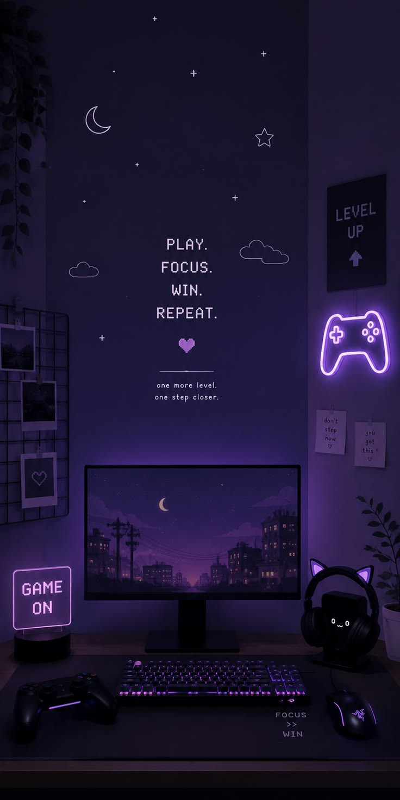

 

### 👋 Sobre Mim

Olá, me chamo Luana, atualmente estou cursando Análise e Desenvolvimento de Sistemas pela Universidade Cidade de São Paulo - Unicid.

---

### 🔭 Áreas de Foco

- 💻 Front-End Development
- 🚀 Full Stack Development
- 🎨 UX Designer
- 🎨 UI Designer
- ⚙️ DevOps Engineer

---

### 💻 Tech Stack & Languages

  

---

### 📬 Meus Contatos

---
## 📊 GitHub Stats

    
  

<!-- Contribution Snake -->
